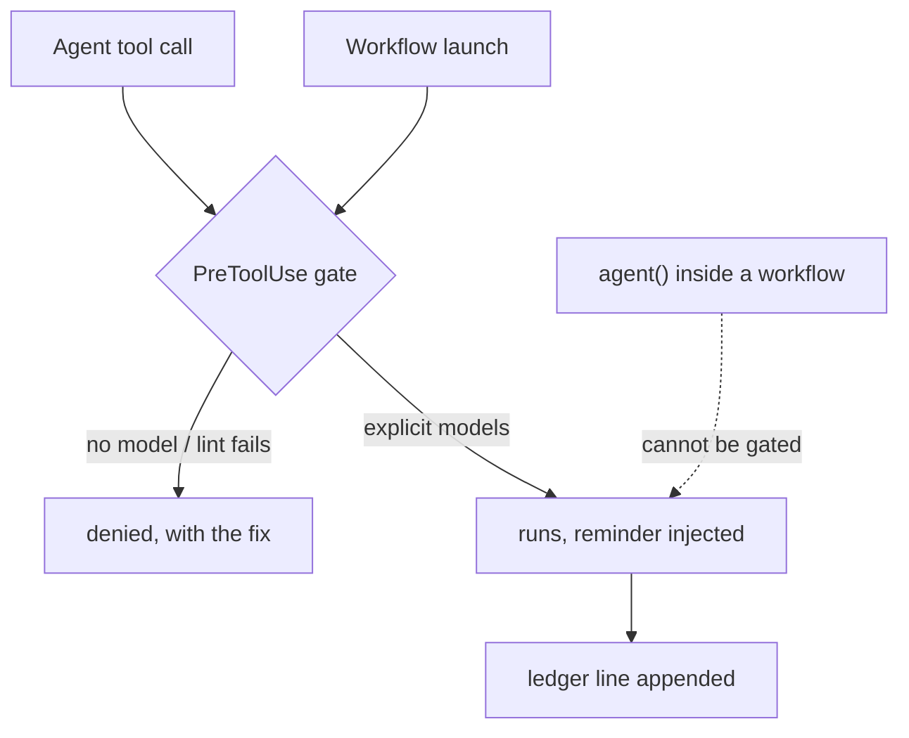

# delegation-tiering

Explicit model/effort tiering for every delegated agent, enforced. Built from an Anthropic article and the official docs, adapted for supervised delegation.

## Install

Via the central marketplace, alongside the other Siegler plugins:

```text
/plugin marketplace add https://github.com/TheRealBillSiegler/siegler-plugins
/plugin install delegation-tiering@siegler-plugins
```

Or direct from this repo, which self-registers as a one-plugin marketplace:

```text
/plugin marketplace add https://github.com/TheRealBillSiegler/delegation-tiering
/plugin install delegation-tiering@delegation-tiering
```

The doubled name in the second form is correct — the marketplace and the plugin share the repo's name.

Requires Claude Code 2.1.295 or later and `node` on `PATH`; the version is the one that honors the gate's fail-closed setting (see Verify).

## Components

| Component | What it does | Fires when |
| --- | --- | --- |
| `skills/delegation-tiering/` | Tier ladder and selection questions for delegated agents (Agent tool, Workflow `agent()` calls, multi-agent plans). | Claude spawns or configures an agent |
| `hooks/agent-model-gate.js` | Denies Agent calls without `model`; lints Workflow script text at launch and denies model-less `agent()` calls. | Every Agent/Workflow call (PreToolUse, matcher `Agent\|Workflow`) |
| `hooks/delegation-ledger.js` | Appends one JSONL line per delegation so tier choices are reviewable, not just explicit. | Every delegation (PostToolUse) |
| `commands/canary.md` | Live end-to-end verification of both gate paths, plus rule-file install. | You run `/delegation-tiering:canary` |

Details:

- **delegation-tiering skill** loads on invocation — the judgment layer, not the always-loaded floor (see Three-layer enforcement below).
- **agent-model-gate** `--test` embeds the regression case for the lint's known failure class: an `agent (` call written with a space must not throw off call-span detection and hide a neighboring model-less call, and a `model:` in later code or in a call's own prompt string must not hide a model-less call, because each call is judged on its own argument list.
- **delegation-ledger** each line records model, agent type, description. A workflow call records `modelLiterals` — named for what it holds: the model strings scanned out of the script text. One entry per literal, not per agent, so a `model:` reused across a fan-out appears once and a non-agent occurrence still counts.

## Verify

In a live session with the plugin enabled:

```text
/delegation-tiering:canary
```

It installs the always-loaded rule file and proves both deny paths live. Run it after installing and after any Claude Code or runtime change. The gate's hook sets `onFailure: "block"`, so when `node` does not resolve, Claude Code blocks every Agent and Workflow call with a hook error that names the missing executable (live 2026-10-15, headless, Claude Code 2.1.296). The ledger hook stays fail-open, so ledger lines stop while the runtime is missing. Claude Code before 2.1.295 does not document the setting and was not tested with it; there, treat the gate as fail-open, the behavior before 0.2.0: a missing `node` let every call through with no error the model sees. the dated claim lives in the repo's [coverage matrix](https://github.com/TheRealBillSiegler/delegation-tiering/blob/main/docs/COVERAGE.md) (dependency A9).

## Configuration

- **Ledger location** — `${CLAUDE_PLUGIN_DATA}/delegation-ledger.jsonl`, the [per-plugin data directory](https://code.claude.com/docs/en/plugins-reference) Claude Code provisions and exports to hook processes. Set `DELEGATION_LEDGER` to redirect it elsewhere.
- **Off switch:** `/plugin disable delegation-tiering` turns the plugin off ([plugins CLI reference](https://code.claude.com/docs/en/plugins/cli-reference)). Uninstalling from the plugin's last scope removes the ledger along with the plugin's data directory — pass `--keep-data` to keep it. The rule file `~/.claude/rules/delegation.md` is left alone: it lives with your personal rules, not with the plugin.

## Three-layer enforcement

1. **Always-loaded rule** (`~/.claude/rules/delegation.md`, installed by the canary command): the standing rule survives compaction and holds without skill invocation — a probabilistic floor: it depends on the model following it, unlike the deterministic hook below.
2. **Skill** (on invocation): the judgment layer — which tier is lowest-sufficient.
3. **Hook** (every Agent/Workflow call): the deterministic gate. It has documented limits and one escape hatch — the delegation-tiering skill's Enforcement section states them operationally, and the repo's [coverage matrix](https://github.com/TheRealBillSiegler/delegation-tiering/blob/main/docs/COVERAGE.md) is the canonical, dated claim set for every path and gap.

The ledger sits alongside as the observability layer: the gate can force models to be *explicit*, but only review of actual choices can show whether tiering judgment held. Its summary, run on demand from the plugin repo, is the evidence base for a deferred hardening — denying `fable` Agent calls that state no rationale — described in the repo's [docs/ROADMAP.md](https://github.com/TheRealBillSiegler/delegation-tiering/blob/main/docs/ROADMAP.md).

### Coverage map



In text: Agent calls and Workflow launches hit the PreToolUse gate, which denies them when no model is named or the lint fails, and otherwise lets them run with a tiering reminder and a ledger line; agent() spawns inside an already-running workflow reach neither the gate nor the ledger.

## Sunset criterion

This plugin is a stopgap for a missing platform feature, not a product to defend. If Claude Code ships native per-delegation model routing (demand is tracked upstream in anthropics/claude-code#27665; #44976 and #67898 closed without shipping it), verify parity against the repo's [docs/COVERAGE.md](https://github.com/TheRealBillSiegler/delegation-tiering/blob/main/docs/COVERAGE.md) — every delegation path, deterministically enforced — and archive this plugin. The repo's drift pipeline exists to notice that day, not to outlive it.

## Source fidelity

Every claim in this plugin carries one of three provenance tiers — article digest, doc page, or dated live test — defined in the repo's [Anchoring policy](https://github.com/TheRealBillSiegler/delegation-tiering/blob/main/docs/REMEDIATION.md#anchoring-policy). The repo's [coverage matrix](https://github.com/TheRealBillSiegler/delegation-tiering/blob/main/docs/COVERAGE.md) names the doc page behind each mechanic; where the docs are silent, the claim says so. Everything used to *build, verify, and maintain* the plugin — evals, dated article digests, verification dates, drift watching — is in the [plugin repo](https://github.com/TheRealBillSiegler/delegation-tiering) ([docs map](https://github.com/TheRealBillSiegler/delegation-tiering/blob/main/docs/README.md)), not in the installed payload: the payload carries what Claude needs to apply the skill, not the apparatus that built it.

## Design rationale

Why bottom-up, when the source article's default is top-down: the article recommends "start with the most intelligent generally available model and use effort level to dial in performance and cost." This plugin deliberately takes the article's alternative path because it operates strictly downstream of the session-model choice — an orchestrator, Opus by default in Claude Code, stays in the loop, writing the spec, choosing the tier, and reviewing the output. Supervision flips the risk asymmetry: under-provisioning is caught at review and upgraded on evidence, while over-provisioning multiplies across every fan-out. The top of the ladder follows Anthropic's current default order ([choosing a model](https://platform.claude.com/docs/en/about-claude/models/choosing-a-model)): opus takes the open adversarial gate, open-ended design, and security-boundary reads, and fable takes what opus at xhigh falls short on. The evidence behind that ruling is in the repo's [lineup research record](https://github.com/TheRealBillSiegler/delegation-tiering/blob/main/docs/research/lineup-5.5-renovation-2026-10-08.md). In Claude Code's own comparison of ways to combine model strengths ([advisor page](https://code.claude.com/docs/en/advisor), "Compare with related features"), this plugin is the "Subagents with model set" row: the chosen model runs for the entire delegated subtask. The advisor tool is the sibling row, a stronger model consulted at decision points mid-task; when a session runs a cheaper main model with an advisor attached, that advisor is the executor's escalation path, and delegated gates still follow the ladder. With no orchestrator in the loop, the premise is gone, and the skill says to start at Anthropic's default model and change models only on that page's own trigger.

The skill's selection questions 1–3 adapt three of the article's four (task difficulty, latency, unit economics); the access-constraints question is deliberately dropped — every model available to the session is equally accessible to a delegated agent, so availability is already folded into the skill's missing-model rule. Question 4 (did design already happen?) is a delegation-specific addition with no article counterpart.
